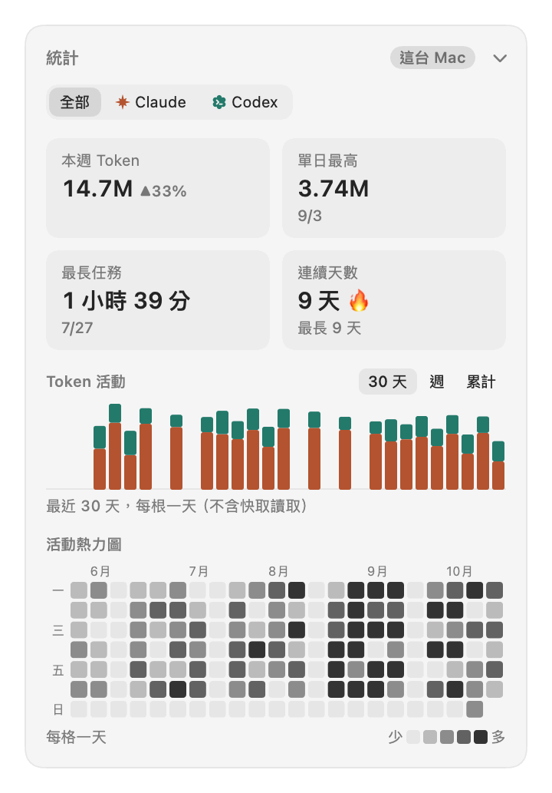
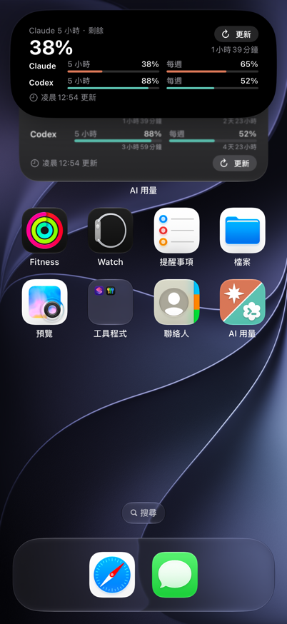

# AI Usage Monitor

[](https://github.com/kevin930326/ai-usage-monitor/actions/workflows/ci.yml)

隨時查看 **Claude** 與 **Codex** 的剩餘使用額度（5 小時／每週）：iPhone 鎖定畫面的 Live Activity 與小工具、Apple Watch、Mac 選單列。Mac 面板另外顯示額度走勢、消耗熱力圖、這台 Mac 的 Token 統計與兩家服務的狀態。只用其中一個服務也可以。

> 目前發布的版本是 [0.5.0](CHANGELOG.md#050---2026-10-21)；之後的 Mac 面板（v1.5～v1.8）、iPhone 小工具與 Token 統計已在 `main`，尚未發版，見 [CHANGELOG](CHANGELOG.md) 的 Unreleased 與[里程碑](docs/03-development-workflow.md#1-里程碑)。

<p align="center">
  <picture>
    <source media="(prefers-color-scheme: dark)" srcset="docs/images/mac-panel-dark.png">
    
  </picture>
  &nbsp;
  
</p>

<p align="center">
  
  &nbsp;
  
</p>

截圖都是示範資料（Debug 版的 `AUM_DEMO`／`scripts/make-demo-history.py`），不是真實用量。

## 功能

| 平台 | 功能 |
|---|---|
| iPhone | 鎖定畫面與動態島的 Live Activity（剩餘最少的額度、各額度進度條、重置倒數、卡片上的「更新」按鈕）；捷徑動作「重新啟動用量監看」讓卡片整天顯示；主畫面小工具（小／中／大）與鎖定畫面小工具（圓形／矩形／單行）；過期資料轉灰、重置後顯示「已重置」；可切換顯示已用或剩餘 % |
| Apple Watch | 手錶 App 與錶面複雜功能（圓形、矩形、單行）；智慧型堆疊顯示 iPhone 的 Live Activity；設定由 iPhone 傳過來，手錶不需要輸入 |
| Mac 選單列 | 選單列圖示（雙圓環）顯示最吃緊額度；卡片式面板：建議接下來用、各額度與「照目前速度」的預測、接下來的重置（8 小時時間軸與每週額度可撐到星期幾）、本週額度走勢、額度消耗熱力圖、這台 Mac 的 Token 統計（本週、單日最高、最長任務、連續天數、活動熱力圖）、服務狀態（分辨「服務異常」與「額度用完」）；完整統計視窗；通知（剩不到 20%、用得太快、額度重置；「剩不到 20%」預設開，其他預設關）；右鍵選單與全域快捷鍵；卡片可排序、收合、隱藏 |
| 收集器 | launchd 每 5 分鐘執行 Claude Code 的 `/usage` 與 Codex CLI 的 `app-server` 取得額度，寫本機快照、額度歷史與 Token 統計，並上傳精簡快照到你自己的中繼 |

<p align="center">
  <picture>
    <source media="(prefers-color-scheme: dark)" srcset="docs/images/mac-stats-window-dark.png">
    
  </picture>
</p>

## 系統概觀

```
Mac 收集器 (Python, launchd) ──POST──▶ Cloudflare Worker (KV) ◀──GET── iPhone App、小工具、Live Activity、Apple Watch
        │                                                              ▲
        ▼                                                    iOS 捷徑自動化：定時重開 Live Activity
本機 usage.json、history.sqlite3、service-status.json ◀──讀── Mac 選單列 App（不連網）
```

- **收集器不讀取任何服務的 token**：Claude 用量由未修改的 Claude Code 自己的 `/usage` 取得（[ADR-0006](docs/adr/0006-claude-usage-via-cli.md)），Codex 用量由 Codex CLI 自己的 `app-server` 取得（[ADR-0007](docs/adr/0007-codex-usage-via-app-server.md)）。
- 不需付費 Apple Developer 帳號：用「捷徑定時重開 + 按鈕手動更新」繞過 Live Activity 的 8 小時上限，免費 Apple ID 的 7 天簽署期限可用每週自動重裝處理。

## 文件

| 文件 | 內容 |
|---|---|
| [需求規格](docs/01-requirements.md) | 功能需求、非功能需求、範圍 |
| [系統架構](docs/02-architecture.md) | 元件、資料格式、失敗處理 |
| [開發流程](docs/03-development-workflow.md) | 里程碑、分支、commit、PR 規範 |
| [相關專案調查](docs/04-related-work.md) | 既有開源方案比較與本專案定位 |
| [手動測試清單](docs/manual-test-checklist.md) | 模擬器與實機的操作步驟與預期結果 |
| [Windows 收集器](docs/windows.md) | Windows PC 的 Token 統計：安裝、移除、手動確認 |
| [第二層：多台電腦的 Token 合併](docs/tier2-setup.md) | 選用：D1、裝置密鑰、Mac 與 PC 的設定、換新與撤銷 |
| [架構決策紀錄 (ADR)](docs/adr/) | 重要技術選擇的理由 |
| [CHANGELOG](CHANGELOG.md) | 各版本的變更 |

## 專案結構

```
collector/   Mac 端用量收集器 (Python，只用標準函式庫)
relay/       Cloudflare Worker 中繼 API
apple/       UsageKit 共用套件、iOS App + Live Activity + 小工具、Mac 選單列 App、Apple Watch App
fixtures/    三個元件測試共用的範例 usage.json
scripts/     verify-all.sh、install-mac-app.sh、reinstall-ios.sh、截圖與效能量測工具
docs/        需求、架構、ADR、手動測試清單、README 截圖
```

```bash
scripts/verify-all.sh              # 全部測試 + iOS／Mac／手錶的 Debug 與 Release 建置 + Release 不含 Debug 程式碼的檢查
SKIP_LINUX=1 scripts/verify-all.sh # 沒有 Docker 時略過 Linux 的 UsageKit 測試
```

## 安裝

只用 Claude 或只用 Codex 都可以，不必兩個都有。需要一台常開（或常醒）的 Mac；只想在 Mac 上看，可以略過中繼與 iPhone。

### 1. 收集器（Mac）

前置：Python 3.10 以上，並在 Mac 登入要監看的服務（至少一個）：Claude 在終端機執行 `claude` 並 `/login`；Codex 執行 `codex login`。

```bash
collector/scripts/install-launchd.sh
```

安裝腳本會偵測這台 Mac 登入過哪些服務，只收集那些服務，並印出結果，例如「Claude 用量：啟用」「Codex 用量：未啟用（沒有登入過 Codex CLI）」。沒用的服務不會出現在 App 上，也不會被當成錯誤。之後登入了另一個服務，重新執行 `install-launchd.sh` 即可加入。移除：`collector/scripts/uninstall-launchd.sh`（會詢問是否一併刪除額度歷史，預設保留）。細節見 [collector/README.md](collector/README.md)。

### Windows PC（選用）

Windows PC 也可以用同一份收集器統計這台電腦的 Token（預設不收集額度、不上傳）：見 [docs/windows.md](docs/windows.md)。要在 Mac 的面板看到所有電腦的合計，另外設定第二層：見 [docs/tier2-setup.md](docs/tier2-setup.md)。

### 2. Mac 選單列 App

需要 Xcode（有裝 XcodeGen 時會先重新產生專案）。

```bash
scripts/install-mac-app.sh
```

以 Release 建置、安裝到「應用程式」並打開；之後要更新也是同一個指令。設定 › 一般 可開「登入時自動打開」。細節見 [apple/MacMenuBar/README.md](apple/MacMenuBar/README.md)。

### 3. 中繼 API（給 iPhone 與手錶）

需要 Cloudflare 帳號（免費方案即可）。依 [relay/README.md](relay/README.md#部署) 部署 Worker 並產生兩把不同的密鑰（寫入、讀取），然後讓收集器開始上傳：

```bash
collector/scripts/set-relay.sh https://ai-usage-relay.<你的帳號>.workers.dev
```

寫入密鑰存在 Mac 的 Keychain，讀取密鑰之後填進 iPhone App。

### 4. iPhone 與 Apple Watch

```bash
brew install xcodegen
cd apple/iOSApp && xcodegen generate && open AIUsageMonitor.xcodeproj
```

在 Xcode 的 Signing & Capabilities 選自己的 Team（免費 Apple ID 即可）並安裝到 iPhone，打開 App 在設定填入中繼網址與讀取密鑰。鎖定畫面卡片要整天顯示，照 [apple/iOSApp/README.md](apple/iOSApp/README.md#捷徑讓卡片整天顯示) 設定捷徑自動化；免費 Apple ID 的 App 7 天後失效，可用[每週自動重新安裝](apple/iOSApp/README.md#每週自動重新安裝免費-apple-id)。

手錶 App 在 `apple/WatchApp`（[README](apple/WatchApp/README.md)），以同樣方式建置安裝；打開手錶 App 時會向 iPhone 要中繼設定。

## 隱私與安全

原則：

- 收集器**不讀取任何服務的 token**，token 只由各自的 CLI 在 Mac 上使用（NFR-1）。
- **離開這台 Mac 的使用者資料只有上傳到你自己中繼的用量快照**（方案名稱與各額度的百分比、重置時間）。額度歷史、Token 統計、對話紀錄的任何內容、服務狀態都只留在本機。
- 例外是選用的**第二層**（[docs/tier2-setup.md](docs/tier2-setup.md)，預設關閉）：設定後每台電腦把 Token 的**每日加總**上傳到你自己的中繼——只有日期、服務、模型名稱、輸入／快取寫入／快取讀取／輸出／推理 Token、任務秒數合計與最長任務；不含每小時資料、任務次數、專案名稱、路徑、檔名、對話內容、session ID 或訊息 ID。
- 中繼的讀取與寫入密鑰分開（NFR-2）。所有網路請求都是 HTTPS，各 App 沒有 ATS 例外。

### 讀取的檔案與欄位

| 讀取者 | 檔案或來源 | 取用的內容 | 不取用（舉例） |
|---|---|---|---|
| 收集器 | `claude -p /usage`、`claude auth status` 的輸出 | 各額度的已用 %、重置時間；方案名稱 | email 等其餘輸出直接丟棄 |
| 收集器 | `codex app-server` 的 `account/rateLimits/read` 回應 | 各額度的已用 %、重置時間、方案名稱 | 帳號 ID 等其餘欄位 |
| 收集器 | `~/Library/Application Support/AIUsageMonitor/config.json` | 中繼網址、`claude`／`codex` 路徑、啟用的服務、對話紀錄資料夾 | — |
| 收集器 | Keychain `AIUsageMonitor-relay-write` | 中繼寫入密鑰（上傳時使用） | — |
| 收集器（第二層） | Keychain `AIUsageMonitor-device-key`、`AIUsageMonitor-relay-read`；Windows 認證管理員 `AIUsageMonitor/device-key` | 這台電腦的寫入密鑰（上傳每日加總）、讀取密鑰（只有 Mac，下載其他電腦的加總） | — |
| 收集器 | Claude Code 對話紀錄 `<claude>/projects/*/<uuid>.jsonl`、`…/<uuid>/subagents/*.jsonl` | assistant 行：`timestamp`、`message.id`、`requestId`、`message.model`、`message.usage` 的四種 Token 數、`isSidechain`；user 行：`timestamp`、`isMeta`、`isSidechain`、`message.content` **是否為** `tool_result`（只判斷型別） | 對話文字、`cwd`、`gitBranch`、附件、檔案快照、`lastPrompt`、`customTitle` |
| 收集器 | Codex 對話紀錄 `<codex>/sessions/YYYY/MM/DD/rollout-*.jsonl`、`<codex>/archived_sessions/rollout-*.jsonl` | `token_usage_record` 的 `response_id`、`usage`、`timestamp`；`token_count` 的 `info.total_token_usage`、`timestamp`；`turn_context` 的 `model`；`task_complete` 的 `turn_id`、開始與結束時間、`duration_ms` | `last_agent_message`、`cwd`、`workspace_roots`、`response_item` 的一切、`rate_limits` |
| 收集器 | `https://status.claude.com/api/v2/summary.json`、`https://status.openai.com/api/v2/summary.json`（公開，不帶任何密鑰或 cookie） | 整體狀態、異常元件的名稱與狀態、未解決事件的名稱與影響程度（各最多 8 項、120 字） | 事件內文、連結 |
| Mac 選單列 App | `usage.json`、`history.sqlite3`、`service-status.json`（同一個資料夾） | 全部（都是收集器寫的、不含帳號資訊） | — |
| iPhone、小工具、手錶 | 你的中繼 `GET /usage` | 用量快照 | — |

對話紀錄的規則（[ADR-0009](docs/adr/0009-local-history-and-token-stats.md) 第 3 節）：只列舉上表的一般檔案，不跟隨符號連結；每一行先以位元組比對篩選，解析成 JSON 後**立刻**只取白名單欄位、不保留原始行；超過 4 MB 的行略過。資料庫的 `file_key` 只用檔名中的 UUID，不含專案資料夾名稱；模型名稱只收 `claude-`、`gpt-`、`codex-`、`o` 加數字開頭的，其他記為 `other`。例外只記錄類別名稱與檔案序號，不記錄檔名、路徑或行內容。限制：JSON 無法只解析部分欄位，篩選過的行仍會整行載入記憶體再丟棄。

**從不讀取**：`~/.codex/auth.json`、`~/.claude/.credentials.json`、Keychain 的 `Claude Code-credentials`、瀏覽器 cookie、`~/.claude.json`、`settings.json`、`config.toml`、`history.jsonl`、`tool-results/`、`~/.codex/*.sqlite`，以及上表以外的任何檔案。收集器有測試掃描原始碼確認不讀憑證，並確認檔案列舉只回傳上表的檔案。

### 寫入的檔案

| 寫入者 | 位置 | 內容 |
|---|---|---|
| 收集器 | `~/Library/Application Support/AIUsageMonitor/usage.json` | 最新快照（與上傳的內容相同） |
| 收集器 | `~/Library/Application Support/AIUsageMonitor/history.sqlite3`（含 `-wal`、`-shm`，權限 `0600`） | 額度歷史：每 5 分鐘每個額度一筆「時間、服務、額度 id、已用 %、重置時間」與每次收集是否成功；Token 統計：每天／每小時 × 服務 × 模型的四種 Token 數（Codex 另有推理明細）、任務數與任務時間、個人紀錄、各紀錄檔讀到哪裡（以 UUID 識別）、已計入的訊息與任務 ID；隨機裝置 ID、裝置名稱固定為「這台 Mac」、保留期間。**不存**方案名稱、錯誤訊息、帳號資訊、對話內容、路徑或專案名稱。預設保留 1 年，35 天前的額度歷史降為每小時一筆 |
| 收集器 | `~/Library/Application Support/AIUsageMonitor/service-status.json`（`0600`） | 兩家狀態頁的精簡結果（見上表） |
| 收集器（第二層） | `history.sqlite3` 的 `upload_state`、`devices` 與 `daily_tokens` 的其他 `device_id` 列 | 每列上次上傳的數值雜湊與時間；中繼的裝置清單（名稱、最後上傳時間）；其他電腦的每日加總（只在 Mac 有讀取密鑰時）。`set-tier2.sh --disable` 刪除其他電腦的資料 |
| `set-tier2.sh`／`set-tier2.ps1` | Keychain／Windows 認證管理員、`config.json` | 第二層的密鑰；`token_sync`、中繼網址（不含密鑰） |
| 收集器的安裝腳本 | `config.json`、`~/Library/LaunchAgents/io.github.kevin930326.ai-usage-monitor.plist` | 設定；launchd 排程 |
| `set-relay.sh` | Keychain `AIUsageMonitor-relay-write`、`config.json` | 中繼寫入密鑰；中繼網址（不含密鑰） |
| 收集器 | `~/Library/Logs/AIUsageMonitor/collector.log` | 錯誤訊息（不含 token、Claude Code 的輸出或對話紀錄的內容） |
| Mac 選單列 App | App 的 UserDefaults | 選單列圖示樣式與顯示的額度（`menuBar.*`）、面板設定（`panel.*`：卡片順序、收合、走勢與統計的範圍）、通知開關（`notify.low`／`notify.tooFast`／`notify.reset`）、啟動時是否已詢問過通知權限（`notify.askedAtLaunch`）與已通知的事件鍵（`notify.sent`，保留 8 天）、快捷鍵（`hotKey.panel`）、「更新」觸發收集器的時間（`collector.kicks`） |
| Mac 選單列 App | `history.sqlite3` | 只在設定的「清除歷史」「縮短保留期間」「清除並重新掃描」確認後寫入 |
| Mac 選單列 App | 你選擇的位置 | 「匯出額度 CSV」：每小時的額度歷史；「匯出 Token CSV」：每日 Token（日期、服務、模型、四種 Token、任務數與秒數） |
| Mac 選單列 App | 通知中心 | 通知內容（服務、額度名稱與剩餘 %）。「剩不到 20%」預設開，第一次打開 App 時由系統詢問是否允許；另外兩種只在你打開開關後 |
| Mac 選單列 App | 系統的登入項目（`SMAppService`） | 只在你打開「登入時自動打開」後；關掉開關即移除 |
| Mac 選單列 App | 標準錯誤輸出（stderr，不寫入檔案） | 讀取的資料夾路徑、資料時間、送出的通知種類與服務／額度 id、觸發收集器的結束碼；不含用量數字或帳號資訊 |
| 中繼（Cloudflare） | Worker KV `latest`；secrets `READ_TOKEN`、`WRITE_TOKEN` | 最新一筆快照；兩把密鑰 |
| 中繼（第二層） | D1 `devices`、`daily_tokens`；secret `ADMIN_TOKEN` | 裝置名稱、寫入密鑰的 SHA-256、建立／撤銷／最後上傳時間；各電腦的每日加總（以裝置、日期、服務、模型覆蓋寫入）；裝置管理密鑰 |
| iPhone | Keychain（`AfterFirstUnlockThisDeviceOnly`，不同步到 iCloud） | 中繼**讀取**密鑰；App 與小工具以 Keychain 群組共用同一個項目 |
| iPhone | App Group `group.io.github.kevin930326.AIUsageMonitor`：UserDefaults（`relayURL`、`displayMode`）與 `usage.json` | 中繼網址、顯示已用／剩餘；最後一份快照（小工具抓不到中繼時顯示） |
| iPhone | Live Activity 與小工具 | 各額度百分比、重置時間、方案、錯誤訊息；**鎖定時也看得到** |
| Apple Watch | Keychain（`AfterFirstUnlockThisDeviceOnly`）、UserDefaults（`relayURL`）、App Group 的 `usage.json` | 讀取密鑰、中繼網址、最新快照（給複雜功能，**錶面上隨時看得到**百分比） |

iPhone 以 WatchConnectivity `sendMessage` 把中繼網址與讀取密鑰傳給開著的手錶 App，系統不保存訊息（FR-30）。寫入密鑰只存在 Mac 的 Keychain 與 Cloudflare，不會傳到 iPhone 或手錶。

### 網路請求

| 發出者 | 目的地 | 認證 | 傳送／取得的內容 | 時機 |
|---|---|---|---|---|
| Claude Code（由收集器執行） | Anthropic | Claude Code 自己處理，收集器不讀取、不持有 token | 取得 Claude 額度與方案名稱 | launchd 每 5 分鐘 |
| Codex CLI（由收集器執行） | OpenAI | Codex CLI 自己處理，收集器不讀取 `~/.codex/auth.json` | 取得 Codex 額度與方案名稱 | launchd 每 5 分鐘 |
| Mac 收集器 | 你的 Cloudflare Worker `POST /usage` | 寫入密鑰 | 用量快照（見下方） | 每 5 分鐘，有設定中繼時 |
| Mac、Windows 收集器（第二層） | 你的 Worker `POST /tokens/daily` | 這台電腦的寫入密鑰 | 有變動的每日加總（每批最多 400 列）；沒有變動時不送（第一次送一批空的，取得自己在中繼上的 device_id） | 每小時＋日期改變後的第一輪，只在設定第二層後 |
| Mac 收集器（第二層） | 你的 Worker `GET /tokens/daily` | 讀取密鑰 | 取得其他電腦的每日加總與裝置清單 | 每小時，只在 Mac 存了讀取密鑰時 |
| `scripts/relay-device.sh` | 你的 Worker `/devices` | 管理密鑰（提示輸入，不存檔） | 新增、列出、換新、撤銷裝置 | 只在你執行時 |
| Mac 收集器 | `status.claude.com`、`status.openai.com` | 無（只有固定的 User-Agent） | 取得公開的服務狀態，不送出任何使用者資料 | 至少間隔 4 分鐘 |
| iPhone App（含 Live Activity 的「更新」按鈕與捷徑） | 你的 Worker `GET /usage` | 讀取密鑰 | 取得快照 | 打開 App、回到前景、下拉、按卡片上的「更新」、捷徑自動化 |
| iPhone 主畫面／鎖定畫面小工具 | 你的 Worker `GET /usage` | 讀取密鑰 | 取得快照 | 約每 25 分鐘（資料過期時每小時），受 WidgetKit 每日次數限制；按小工具上的「更新」 |
| Apple Watch App | 你的 Worker `GET /usage` | 讀取密鑰 | 取得快照 | 打開 App、回到前景、背景重新整理（約每 30 分鐘） |
| Mac 選單列 App | App 本身不連網；按服務狀態的「狀態頁」時以預設瀏覽器打開 status.claude.com／status.openai.com，按「更新」時執行 `launchctl kickstart` 讓收集器立即執行 | — | — | 只在你按下時 |
| Live Activity 畫面、錶面複雜功能 | 不連網 | — | 只讀 App 傳來的資料 | — |

上傳到 Worker 的快照只有：`schema_version`、`updated_at`，以及每個服務的方案名稱（如 Max、Team）、錯誤訊息（不含 token）、各額度的 id／名稱／已用 %／重置時間／是否隱藏。不含 token、email、帳號 ID、對話內容、Token 統計或額度歷史。Worker 會驗證格式並只保存上述欄位，其他欄位一律移除；只保存最新一筆（KV 的 `latest`），回應帶 `Cache-Control: no-store`。

Debug 版本的示範模式、截圖工具與環境變數覆寫（`AUM_*`）都以 `#if DEBUG` 排除，Release 版本不包含（`scripts/verify-all.sh` 會檢查 Release 執行檔中沒有這些字串；Swift 把 15 個位元組以內的字串直接編進指令、`strings` 看不到，所以另外以 `scripts/check-debug-env.py` 檢查原始碼：`"AUM_…"` 只能出現在 `#if DEBUG` 裡，`AUM_TESTING` 例外）。`AI_USAGE_MONITOR_HOME` 在 Release 也有效，與收集器相同，只影響讀取本機檔案的位置。

### 已知取捨

- 手錶的設定只在手錶 App 開啟、且 iPhone 在附近時同步。在 iPhone 改了網址或密鑰後，要打開一次手錶 App 才會套用。
- Mac 選單列 App 不開沙盒（需要讀取 `~/Library/Application Support`），以 Sign to Run Locally 簽署、未開 Hardened Runtime。它不連網，也不讀任何 token 或對話紀錄。
- Token 統計只算這台 Mac 的 Claude Code 與 Codex CLI；網頁、手機 App、其他電腦與雲端 session 不在內（面板標「這台 Mac」）。設定第二層後可切換「所有電腦（N 台）」，仍不含網頁、手機 App 與雲端 session。
- Spotlight：資料夾 `~/Library/Application Support/AIUsageMonitor`（`usage.json`、`history.sqlite3`）只有數字，但不需要被搜尋。建置資料夾（`build/`、`~/Library/Caches/AIUsageMonitor/DerivedData`）由各腳本放 `.metadata_never_index`，新版 macOS 不一定採用這個檔案；要確實排除，在「系統設定 → Spotlight → 搜尋隱私權」（或「Spotlight 隱私權」）加入 repo 的 `build/` 與上面兩個資料夾。

## 免責聲明

本專案為個人學習作品，與 Anthropic、OpenAI 無關。服務圖示為原創，不使用官方 logo。Claude 用量取自 Claude Code `/usage` 指令的輸出、Codex 用量取自 Codex CLI 使用的非公開介面、Token 統計取自兩者的本機對話紀錄格式，都**沒有文件保證**，可能隨時變更或失效。
