**English** | [繁體中文](README.zh-TW.md)

# AI Usage Monitor

[](https://github.com/kevin930326/ai-usage-monitor/actions/workflows/ci.yml)

See how much of your **Claude** and **Codex** usage limits (5-hour / weekly) is left at any time: Live Activity and widgets on the iPhone Lock Screen, Apple Watch, and the Mac menu bar. The Mac panel also shows limit trends, a consumption heatmap, token statistics for this Mac, and the status of both services. Using only one of the two services works too.

> The apps' interface is in Traditional Chinese; in this README, UI labels are quoted in Chinese with an English gloss the first time they appear. The detailed documentation linked below (`docs/`, ADRs, component READMEs) is in Traditional Chinese.

> The current version is [1.0.0](CHANGELOG.md#100---2026-10-29): the Mac `.dmg` and one-line installer, the Windows collector's one-line installer and the Windows desktop app's zip are on [Releases](https://github.com/kevin930326/ai-usage-monitor/releases). See [Installation](#installation) to install, and the [CHANGELOG](CHANGELOG.md) for what changed in each version.

<!-- 同一排的圖以寬度算成等高（SOURCES.tsv 的尺寸 × 寬度）；用 width 不用 height，窄螢幕時換行而不是壓扁 -->
<p align="center">
  <picture>
    <source media="(prefers-color-scheme: dark)" srcset="docs/images/mac-panel-top-dark.png">
    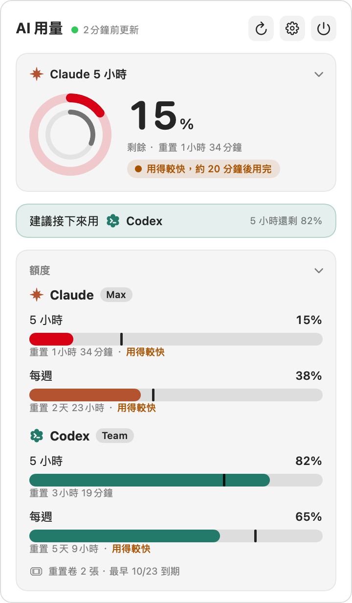
  </picture>
  &nbsp;&nbsp;
  <picture>
    <source media="(prefers-color-scheme: dark)" srcset="docs/images/iphone-app-dark.png">
    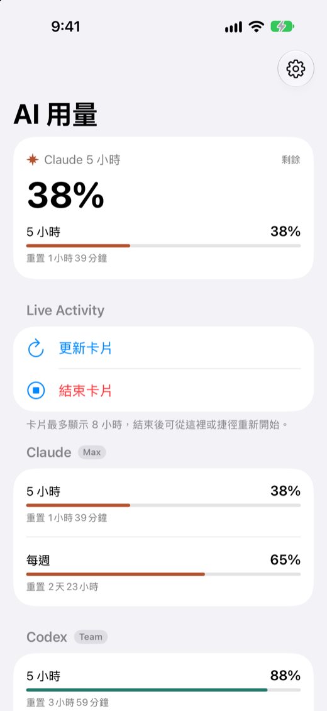
  </picture>
</p>

<p align="center">
  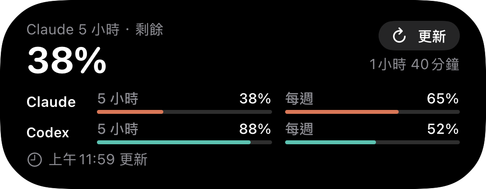
  &nbsp;&nbsp;
  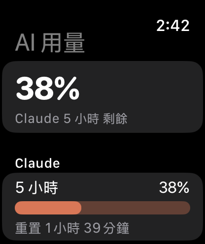
</p>

The notch and character (Mac): move the pointer to the notch to expand it (top); otherwise it stays beside the notch (bottom).

<p align="center">
  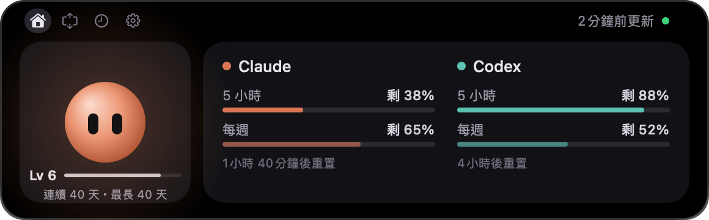
</p>
<p align="center">
  <picture>
    <source media="(prefers-color-scheme: dark)" srcset="docs/images/mac-notch-collapsed-dark.png">
    
  </picture>
</p>

<details>
<summary>See the full Mac panel (upcoming resets, this week's limit trend, limit consumption, token statistics, service status)</summary>

<p align="center">
  <picture>
    <source media="(prefers-color-scheme: dark)" srcset="docs/images/mac-panel-dark.png">
    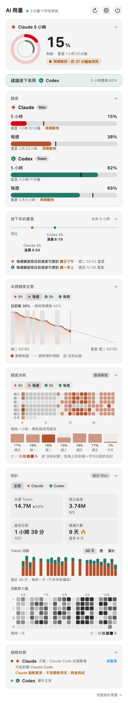
  </picture>
</p>

</details>

All screenshots use demo data (the Debug build's `AUM_DEMO` / `scripts/make-demo-history.py`), not real usage; they are generated by `scripts/update-readme-images.sh` (sources listed in `docs/images/SOURCES.tsv`).

## Features

| Platform | Features |
|---|---|
| iPhone | Live Activity on the Lock Screen and in the Dynamic Island (the lowest remaining limit, a progress bar for each limit, reset countdowns, and an 「更新」 ("Refresh") button on the card); the Shortcuts action 「重新啟動用量監看」 ("Restart usage monitoring") keeps the card on screen all day; Home Screen widgets (small / medium / large) and Lock Screen widgets (circular / rectangular / inline); stale data turns gray and 「已重置」 ("Reset") is shown after a reset; switch between showing used or remaining %; appearance setting (System, Light, Dark; applies only to the app) and pairing by scanning a QR code on the Mac; the Codex section on the main screen shows the number of reset credits (重置次數卷) and the earliest expiry date (requires redeploying the relay) |
| Apple Watch | Watch app and watch face complications (circular, rectangular, inline); the Smart Stack shows the iPhone's Live Activity; settings are sent over from the iPhone, so nothing needs to be typed on the watch |
| Mac menu bar | The menu bar icon (two rings) shows the lowest remaining limit; card-style panel: which service to use next, each limit with an 「照目前速度」 ("at the current pace") forecast, upcoming resets (an 8-hour timeline and which weekday the weekly limit will last until), this week's limit trend, a limit consumption heatmap, token statistics for this Mac (this week, best single day, longest task, streak, activity heatmap; with or without cache reads), service status (distinguishes "service outage" from "limit used up"); a full statistics window; the number of Codex reset credits and their expiry dates (hover to list each one); notifications (below 20% left, using too fast, limit reset, a reset credit expiring within 3 days; 「剩不到 20%」 ("below 20%") and 「重置卷快到期」 ("reset credit expiring soon") are on by default, the others off); a right-click menu and a global keyboard shortcut; cards can be reordered, collapsed and hidden; appearance setting (System, Light, Dark); a setup wizard on first launch |
| Mac notch and character | Move the pointer to the notch and it expands into a panel: a character (Claude or Codex) on the left and both services' limits on the right; when collapsed, a mini character and a ring for the lowest remaining limit sit beside the notch. The character's face follows your limits and service status; it types while an AI is running, falls asleep when idle for a while, reacts to clicks, pinches and circling, and levels up with your daily tokens. Screens without a notch get one drawn in the middle of the menu bar |
| Windows PC | The collector counts this PC's tokens; the desktop app's floating icon is either the two rings or the character (the same one as in the Mac notch); click it to open the card panel |
| Collector | Every 5 minutes, runs Claude Code's `/usage` and Codex CLI's `app-server` to get usage limits, writes a local snapshot, limit history and token statistics, and uploads a compact snapshot to your own relay. Run either by the app's built-in background collector or by the launchd job installed with `install-launchd.sh`; the two never run at the same time |

Token statistics: the panel's statistics card switches between All, Claude and Codex, and between including and excluding 「含快取讀取」 ("including cache reads"; off by default — cache reads are conversation context the AI reads again, and usually make up most of the total) (left); the 「完整統計」 ("Full Statistics") window shows a whole year, each model, and time of day (right).

<p align="center">
  <picture>
    <source media="(prefers-color-scheme: dark)" srcset="docs/images/mac-stats-switch-dark.gif">
    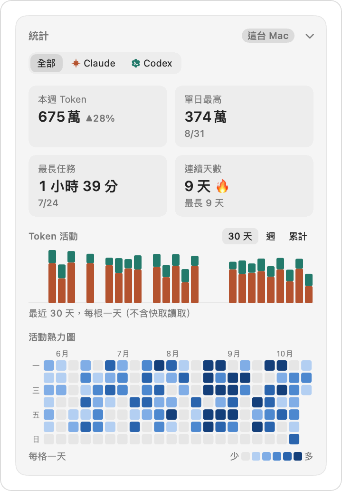
  </picture>
  &nbsp;&nbsp;
  <picture>
    <source media="(prefers-color-scheme: dark)" srcset="docs/images/mac-stats-window-dark.png">
    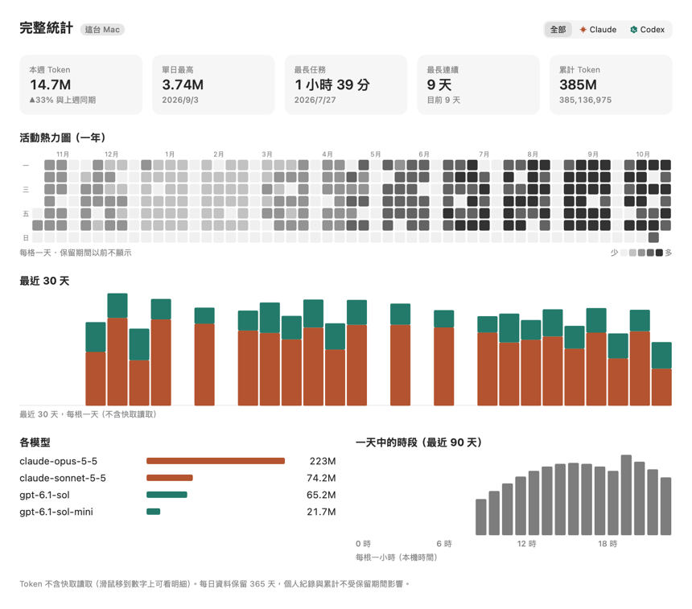
  </picture>
</p>

Appearance can follow the system or be set to Light or Dark (on the Mac it applies to the panel, Settings, Full Statistics and the setup wizard; on the iPhone it applies only to the app itself):

<p align="center">
  <picture>
    <source media="(prefers-color-scheme: dark)" srcset="docs/images/mac-settings-appearance-dark.png">
    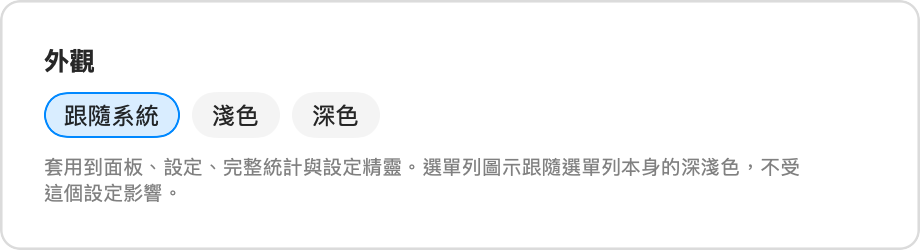
  </picture>
</p>

## System overview

```
Mac collector (Python)  ──POST──▶ Cloudflare Worker (KV) ◀──GET── iPhone app, widgets, Live Activity, Apple Watch
        │                                                              ▲
        ▼                                              iOS Shortcuts automation: restarts the Live Activity on a schedule
Local usage.json, history.sqlite3, service-status.json ◀──read── Mac menu bar app (no network access)
```

- **The collector does not read any service's access token**: Claude usage comes from the unmodified Claude Code's own `/usage` ([ADR-0006](docs/adr/0006-claude-usage-via-cli.md)), and Codex usage comes from Codex CLI's own `app-server` ([ADR-0007](docs/adr/0007-codex-usage-via-app-server.md)).
- No paid Apple Developer account needed: "Shortcuts restarts it on a schedule + a button for manual refresh" works around the Live Activity's 8-hour limit, and the 7-day signing expiry of a free Apple ID is handled by an automatic weekly reinstall.

## Documentation

The documents below are in Traditional Chinese.

| Document | Contents |
|---|---|
| [Requirements](docs/01-requirements.md) | Functional requirements, non-functional requirements, scope |
| [Architecture](docs/02-architecture.md) | Components, data formats, failure handling |
| [Development workflow](docs/03-development-workflow.md) | Milestones, branches, commit and PR conventions |
| [Related work](docs/04-related-work.md) | Comparison with existing open-source projects and where this project fits |
| [Manual test checklist](docs/manual-test-checklist.md) | Steps and expected results on simulators and real devices |
| [Uninstall](docs/uninstall.md) | How to remove each part, and what data is left behind |
| [Windows collector](docs/windows.md) | Token statistics on a Windows PC: install, removal, manual checks |
| [Tier 2: combining tokens across computers](docs/tier2-setup.md) | Optional: D1, device keys, Mac and PC setup, rotation and revocation |
| [Operations runbook](docs/runbook.md) | Steps to follow in order when you replace a computer or lose a phone or watch |
| [Architecture decision records (ADR)](docs/adr/) | The reasons behind important technical choices |
| [CHANGELOG](CHANGELOG.md) | Changes in each version |

## Project structure

```
collector/   Usage collector on the Mac (Python, standard library only)
relay/       Cloudflare Worker relay API
apple/       UsageKit shared package, iOS app + Live Activity + widgets, Mac menu bar app, Apple Watch app
windows/     Windows desktop app (WPF: floating ring and panel) and the C# UsageCore; see windows/README.md
fixtures/    Sample usage.json shared by the tests of the three components; logic/ holds calculation goldens shared by Swift and C#
scripts/     verify-all.sh, setup-relay.sh, setup-iphone.sh, install-mac-app.sh, build-release.sh, screenshot and performance tools
docs/        Requirements, architecture, ADRs, manual test checklist, README screenshots
```

```bash
scripts/verify-all.sh              # all tests + Debug and Release builds for iOS / Mac / watch + check that Release contains no Debug code
SKIP_LINUX=1 scripts/verify-all.sh # skip the Linux UsageKit tests when Docker is not available
SKIP_WINDOWS=1 scripts/verify-all.sh # skip the Windows app tests and build when the .NET SDK is not available
```

## Installation

There are three tiers; install only as far as you need. Using only Claude or only Codex is fine. None of the tiers **requires a paid Apple Developer account**, and none requires handing your data to anyone else: the relay runs on your own Cloudflare account (free plan).

| Tier | What you see | Requires | Time |
|---|---|---|---|
| [0. Mac only](#0-mac-only) | Mac menu bar | A Mac (Apple silicon), Claude Code or Codex CLI signed in | About 3 minutes |
| [1. Add iPhone](#1-add-iphone) | iPhone Lock Screen, widgets, Apple Watch | Tier 0, a Cloudflare account (free), Xcode, a free Apple ID | About 20 minutes |
| [2. Add a PC](#2-add-a-pc) | Token statistics for that PC | Windows 10 / 11 | About 5 minutes |

First sign in to the services you want to monitor (at least one): for Claude, run `claude` in a terminal and `/login`; for Codex, run `codex login` (sign in with a ChatGPT account; limits are not visible when signed in with an API key).

### 0. Mac only

**Download and install** (no terminal, no need to install Python yourself): download `AIUsageMenuBar-<version>.dmg` from [Releases](https://github.com/kevin930326/ai-usage-monitor/releases), drag 「AI 用量」 ("AI Usage") into Applications, and on first launch go to System Settings › Privacy & Security and click Open Anyway (the app is ad-hoc signed and not notarized by Apple; see [ADR-0013](docs/adr/0013-download-and-install.md)).

Or use a one-line command (it verifies the SHA-256, installs into Applications and opens the app, without running into Gatekeeper's Open Anyway). The command points to a fixed version (1.0.0 below; for later versions, replace `1.0.0` with a version number from [Releases](https://github.com/kevin930326/ai-usage-monitor/releases)):

```bash
curl -fsSL https://github.com/kevin930326/ai-usage-monitor/releases/download/v1.0.0/install.sh | bash
```

To look before you run it: `curl -fsSLO https://github.com/kevin930326/ai-usage-monitor/releases/download/v1.0.0/install.sh`, read `install.sh`, then `bash install.sh`. install.sh has the SHA-256 of that version's zip hard-coded; it compares it after downloading and stops on a mismatch. It comes from the same Release as the zip, so it protects integrity during download and caching, but it **cannot** protect against the Release itself being replaced ([ADR-0013](docs/adr/0013-download-and-install.md#1-mac-app-的發布格式)).

On first launch a **setup wizard** appears; each step shows ✅ or what needs to be done, with a 「複製」 ("Copy") button when a command is needed. The app has a built-in collector (Python is embedded) that collects in the background every 5 minutes; you can open the wizard again later from 「設定 › 一般 › 重新執行設定精靈」 ("Settings › General › Run Setup Wizard Again").

<p align="center">
  <picture>
    <source media="(prefers-color-scheme: dark)" srcset="docs/images/mac-wizard-dark.png">
    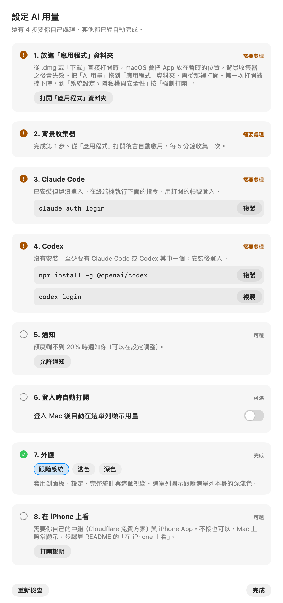
  </picture>
</p>

**If you already use `collector/scripts/install-launchd.sh`**: when the new app detects the old collector it does **not** register another one; it only shows 「可以改用 App 內建的收集器」 ("You can switch to the app's built-in collector") in the setup wizard and in 「設定 › 背景收集器」 ("Settings › Background Collector"). Migration happens only when you click the button (it first confirms the built-in one runs, then disables the old one; the old plist is moved to the Trash). If you don't click it, everything keeps working as before.

**Install from source** (developers): requires Xcode and Python 3.10 or later.

```bash
collector/scripts/install-launchd.sh   # collector (launchd); details in collector/README.md
scripts/install-mac-app.sh             # menu bar app (Release build, installed into Applications)
```

### 1. Add iPhone

The iPhone does not connect to the Mac directly; data goes through your own Cloudflare Worker (the relay). The Mac uploads and the iPhone reads, with two separate keys ([ADR-0001](docs/adr/0001-cloudflare-worker-relay.md)).

The tier 1 scripts are in the source code (this step is needed even if you installed from the DMG). First get the source and enter its folder; run all the following commands in that folder. The Python 3 that comes with Xcode is enough:

```bash
git clone https://github.com/kevin930326/ai-usage-monitor.git
cd ai-usage-monitor
```

1. **Deploy the relay** (requires Node.js 23.6 or later and a free Cloudflare account; the script installs a pinned version of wrangler in `relay/` with `npm ci`):

   ```bash
   scripts/setup-relay.sh --dry-run   # see what it would do first
   scripts/setup-relay.sh             # sign in to Cloudflare → create KV → deploy → generate and set the two keys → write the collector config
   ```

   If a relay is already set up, it stops without overwriting anything. For the manual steps see [relay/README.md](relay/README.md#部署).

2. **Install the iPhone app** (requires Xcode, XcodeGen and a free Apple ID; first sign in under Xcode → Settings → Accounts, connect the iPhone by cable once, tap Trust, and turn on Developer Mode):

   ```bash
   scripts/setup-iphone.sh --auto-reinstall   # build and install; a free Apple ID's signature expires after 7 days, so it reinstalls automatically every 6 days
   ```

3. **Pair**: the Mac terminal shows a QR code; in the iPhone's settings tap 「掃描 QR 碼」 ("Scan QR Code"), confirm the host name, and you're done (the QR code contains only the URL and the read key, and is cleared when you press Enter; [ADR-0012](docs/adr/0012-iphone-pairing.md)).

   ```bash
   scripts/setup-iphone.sh --pair-only qr
   ```

   If using the camera is inconvenient, use a one-time short code instead: `scripts/setup-iphone.sh --pair-only code`, then tap 「輸入短碼」 ("Enter Short Code") on the iPhone (valid for 10 minutes, single use; the relay must be a version deployed after 2026-10-24 to have this endpoint).

<p align="center">
  <picture>
    <source media="(prefers-color-scheme: dark)" srcset="docs/images/iphone-settings-pairing-dark.png">
    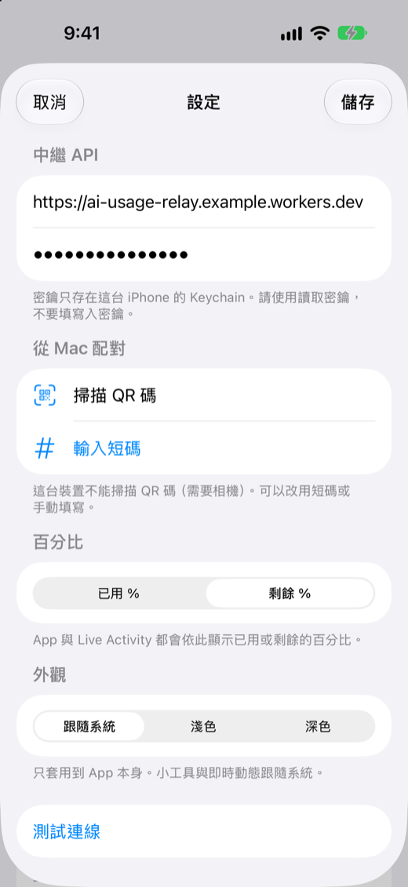
  </picture>
</p>

To keep the Lock Screen card on screen all day, set up the Shortcuts automation as described in [apple/iOSApp/README.md](apple/iOSApp/README.md#捷徑讓卡片整天顯示). The watch app is in `apple/WatchApp` ([README](apple/WatchApp/README.md)) and is built and installed the same way; when opened, the watch app asks the iPhone for the relay settings. For details and the manual method see [apple/iOSApp/README.md](apple/iOSApp/README.md).

### 2. Add a PC

The Windows collector computes token statistics for Claude Code and Codex CLI on that PC (by default it does not collect usage limits and does not upload). Open PowerShell (no administrator rights needed):

```powershell
irm https://github.com/kevin930326/ai-usage-monitor/releases/download/v1.0.0/install.ps1 | iex
```

For later versions, replace the version number in the same way. To look first: `irm https://github.com/kevin930326/ai-usage-monitor/releases/download/v1.0.0/install.ps1 -OutFile install.ps1`, read it, then run it. The SHA-256 check protects the same things as on the Mac.

If Python is missing, it asks whether to install it with winget; downloaded files are installed only after their SHA-256 is verified. For details, options and limitations see [docs/windows.md](docs/windows.md). To see the total across all computers in the Mac panel, set up tier 2 separately: see [docs/tier2-setup.md](docs/tier2-setup.md).

**Viewing usage limits on the PC (Windows desktop app)**: install the collector with `-WithQuota` ([docs/windows.md](docs/windows.md)) so the app has limit data. The same two rings as in the Mac menu bar, or the character, appear on the desktop (draggable, snap to screen edges, hidden in full screen); click to open the card panel. The app reads only the local `usage.json` and does not access the network. Pick one way to install:

- **Download the zip** (no .NET needed): from [Releases](https://github.com/kevin930326/ai-usage-monitor/releases), download `AIUsageMonitor-windows-x64-1.0.0.zip` for your architecture (`-arm64-` for ARM64), compare it with `SHA256SUMS-windows` using `Get-FileHash <zip> -Algorithm SHA256`, extract it to a fixed location and open `AIUsageMonitor.exe`. It has no code signature, so the first launch shows SmartScreen; click More info → Run anyway.
- **Install with the repo's script** (verifies the SHA-256 for you; run it again to update): in the repo folder, run `powershell -ExecutionPolicy Bypass -File scripts\install-windows-app.ps1 -FromRelease`. Without `-FromRelease` it builds from source with the .NET 10 SDK.

For details and the real-device checklist see [windows/README.md](windows/README.md) (ADR-0015).

### Uninstall

See [docs/uninstall.md](docs/uninstall.md): how to remove the Mac app, the built-in or launchd collector, the iPhone app, the relay and the PC parts, and what data is left behind.

## Privacy and security

Principles:

- The collector **does not read any service's access token**; access tokens are used only by each service's own CLI on the Mac (NFR-1).
- **The only user data that leaves this Mac is the usage snapshot uploaded to your own relay** (plan name, each limit's percentage and reset time, and the number of Codex reset credits and their expiry times). Limit history, token statistics, any content of conversation logs, and service status stay only on this machine.
  The exception is [tier 2](docs/tier2-setup.md), if you set it up separately: each computer uploads daily token totals (date, service, model name, each kind of token count, task seconds) to D1 on your own relay, and the Mac downloads those of the other computers; hourly data, task counts, paths, file names, conversation content and IDs are not uploaded. Without that setup, this upload does not happen.
- The relay's read and write keys are separate (NFR-2). All network requests use HTTPS; none of the apps has an ATS exception.

### Files and fields read

| Reader | File or source | What is used | Not used (examples) |
|---|---|---|---|
| Collector | Output of `claude -p /usage` and `claude auth status` | Used % and reset time for each limit; plan name | Email and all other output are discarded |
| Collector | The `account/rateLimits/read` response from `codex app-server` | Used %, reset time and plan name for each limit; the number of available reset credits and each one's expiry time | Account ID, credit balance, and the reset credits' id / title / description / time obtained and other fields. The collector only reads reset credits and never uses them (the code has no method for using one; a test scans to confirm this) |
| Collector | `~/Library/Application Support/AIUsageMonitor/config.json` | Relay URL, `claude` / `codex` paths, enabled services, conversation log folders | — |
| Collector | Keychain `AIUsageMonitor-relay-write` | Relay write key (used when uploading) | — |
| Collector (only after tier 2 is set up) | Keychain `AIUsageMonitor-device-key`, `AIUsageMonitor-relay-read` (Windows: Credential Manager `AIUsageMonitor/device-key`, plus `AIUsageMonitor/relay-read` with `set-tier2.ps1 -ReadKey`) | This computer's write key; the read key used to download other computers' data | — |
| Collector | Claude Code conversation logs `<claude>/projects/*/<uuid>.jsonl`, `…/<uuid>/subagents/*.jsonl` | Assistant lines: `timestamp`, `message.id`, `requestId`, `message.model`, the four token counts in `message.usage`, `isSidechain`; user lines: `timestamp`, `isMeta`, `isSidechain`, **whether** `message.content` is a `tool_result` (only the type is checked) | Conversation text, `cwd`, `gitBranch`, attachments, file snapshots, `lastPrompt`, `customTitle` |
| Collector | Codex conversation logs `<codex>/sessions/YYYY/MM/DD/rollout-*.jsonl`, `<codex>/archived_sessions/rollout-*.jsonl` | `response_id`, `usage`, `timestamp` of `token_usage_record`; `info.total_token_usage`, `timestamp` of `token_count`; `model` of `turn_context`; `turn_id`, start and end time, `duration_ms` of `task_complete` | `last_agent_message`, `cwd`, `workspace_roots`, everything in `response_item`, `rate_limits` |
| Collector | `https://status.claude.com/api/v2/summary.json`, `https://status.openai.com/api/v2/summary.json`, `https://status.claude.com/api/v2/incidents/unresolved.json`, `https://status.openai.com/api/v2/incidents.json` (public; sent without any key or cookie) | Overall status, names and status of affected components, names and impact of unresolved incidents (at most 8 items each, 120 characters); for ongoing incidents that affect the service, also the incident page link (`https://status.claude.com/incidents/<id>` / `https://status.openai.com/incidents/<id>`) and start time ([ADR-0018](docs/adr/0018-quota-forecast-and-service-incidents.md) section 4) | Incident text and updates, other links |
| Mac menu bar app | `usage.json`, `history.sqlite3`, `service-status.json` (in the same folder) | Everything (all written by the collector; no account information) | — |
| iPhone, widgets, watch | Your relay's `GET /usage` | Usage snapshot | — |
| iPhone app | Camera (only when you tap Scan QR Code; VisionKit) | Recognizes only pairing QR codes starting with `aiusage-pair:v1:` (relay URL and read key) | Other QR codes and anything else in view |

Rules for conversation logs ([ADR-0009](docs/adr/0009-local-history-and-token-stats.md) section 3): only the regular files in the table above are enumerated, and symbolic links are not followed; each line is first filtered by a byte match, and after being parsed as JSON only the allow-listed fields are taken **immediately**, without keeping the raw line; lines over 4 MB are skipped. The database's `file_key` uses only the UUID in the file name, not the project folder name; model names are recorded only if they start with `claude-`, `gpt-`, `codex-`, or `o` followed by a digit, and anything else is recorded as `other`. Exceptions record only the class name and the file's sequence number, not the file name, path or line content. Limitation: JSON cannot be parsed for only some fields, so a line that passed the filter is still loaded into memory in full before being discarded.

**Never read**: `~/.codex/auth.json`, `~/.claude/.credentials.json`, the Keychain item `Claude Code-credentials`, browser cookies, `~/.claude.json`, `settings.json`, `config.toml`, `history.jsonl`, `tool-results/`, `~/.codex/*.sqlite`, or any file not in the table above. The collector has tests that scan the source code to confirm it does not read credentials, and that file enumeration returns only the files in the table above.

### Files written

| Writer | Location | Contents |
|---|---|---|
| Collector | `~/Library/Application Support/AIUsageMonitor/usage.json` | Latest snapshot (same as what is uploaded, plus `local_status`: local-only notices such as a renamed damaged history file or low disk space) |
| Collector | `~/Library/Application Support/AIUsageMonitor/history.sqlite3` (including `-wal` and `-shm`, permissions `0600`) | Limit history: one row per limit every 5 minutes with "time, service, limit id, used %, reset time", and whether each collection succeeded; token statistics: the four token counts per day / hour × service × model (Codex also has a reasoning breakdown), task count and task time, personal records, how far each log file has been read (identified by UUID), and message and task IDs already counted; a random device ID, a device name fixed as 「這台 Mac」 ("This Mac"), and the retention period. **Does not store** plan names, error messages, account information, conversation content, paths or project names. Kept for 1 year by default; limit history older than 35 days is reduced to one row per hour |
| Collector | `~/Library/Application Support/AIUsageMonitor/service-status.json` (`0600`) | Compact results from both status pages (see the table above) |
| Collector install script | `config.json`, `~/Library/LaunchAgents/io.github.kevin930326.ai-usage-monitor.plist` | Settings; launchd schedule |
| The app's built-in collector (`usage_collector.setup`) | `config.json` | `claude` / `codex` paths, enabled services; written when the app registers the collector or when 「重新檢查」 ("Check Again") is clicked in the setup wizard (while the built-in collector is running); other fields are kept |
| `setup-relay.sh` | Keychain `AIUsageMonitor-relay-write`, `config.json`, `relay/wrangler.local.toml` (not under version control) | Relay write key; relay URL; KV id and Worker name |
| `set-relay.sh` | Keychain `AIUsageMonitor-relay-write`, `config.json` | Relay write key; relay URL (without the key) |
| Collector | `~/Library/Logs/AIUsageMonitor/collector.log`, `collector.log*.repeats.json` (Windows: `%LOCALAPPDATA%\AIUsageMonitor\collector.log`, `collector.log.repeats.json`) | Error messages (no access tokens, no Claude Code output, no conversation log content); the `.repeats.json` file holds the same lines with times so a repeating error is logged once an hour |
| Mac menu bar app | The app's UserDefaults | Menu bar icon style and the limit shown (`menuBar.*`), panel settings (`panel.*`: card order, collapsed state, ranges for trends and statistics, whether statistics include cache reads), notification switches (`notify.low` / `notify.tooFast` / `notify.reset`), whether notification permission has already been requested at launch (`notify.askedAtLaunch`) and the keys of events already notified (`notify.sent`, kept for 8 days), keyboard shortcut (`hotKey.panel`), times when Refresh triggered the collector (`collector.kicks`), appearance (`app.appearance`), whether the setup wizard has been completed (`wizard.completed`) |
| Mac menu bar app | `~/Library/Application Support/AIUsageMonitor/level.json` (`0600`; renamed to `level.corrupt.json` if it is damaged; only the latest damaged copy is kept) | Mascot level: each day's main token number (date and number, only ever increases), XP and level. Updated when the notch expands and before 「清除歷史」 ("Clear History"); clearing history does not delete it, so the level does not drop (if it can't be saved, history is not cleared) ([ADR-0020](docs/adr/0020-mascot-level.md) section 1) |
| Mac menu bar app | `history.sqlite3` | Written only after you change the retention period (`meta.retention_days`; when extending, also `meta.token_days_from`, the first day that still has daily tokens) or confirm 「清除歷史」 ("Clear History"), 「縮短保留期間」 ("Shorten Retention") or 「清除並重新掃描」 ("Clear and Rescan") in Settings; when it opens the database it sets the file and its `-wal` and `-shm` back to `0600` |
| Mac menu bar app | A location you choose | 「匯出額度 CSV」 ("Export Limits CSV"): hourly limit history; 「匯出 Token CSV」 ("Export Token CSV"): daily tokens (date, service, model, four kinds of tokens, task count and seconds) |
| Mac menu bar app | Notification Center | Notification content (service, limit name and % remaining). Below 20% is on by default, and the system asks whether to allow it the first time you open the app; the other two kinds only after you turn their switches on |
| Mac menu bar app | System login items (`SMAppService`) | Only after you turn on 「登入時自動打開」 ("Open at Login"); removed when you turn the switch off |
| Mac menu bar app | System background items (`SMAppService.agent`) | The LaunchAgent inside the app, `io.github.kevin930326.AIUsageMenuBar.collector` (the built-in collector). The release build registers it on first launch when there is no old collector from `install-launchd.sh`; when there is an old one, it registers only after you click 「改用內建收集器」 ("Switch to Built-in Collector") and moves the old plist to the Trash. Development builds do not register it |
| Mac menu bar app | Standard error (stderr, not written to a file) | Path of the folder being read, data time, the kind of notification sent with the service / limit id, the exit code of the triggered collector; no usage numbers or account information |
| Relay (Cloudflare) | Worker KV `latest`, `pair`, `pair-fail:<first 16 characters of hash>`; secrets `READ_TOKEN`, `WRITE_TOKEN` | The latest snapshot; the SHA-256 of the pairing short code with its expiry time and failure count (expires after 10 minutes); the two keys |
| iPhone | Keychain (`AfterFirstUnlockThisDeviceOnly`, not synced to iCloud) | The relay **read** key; the app and widgets share the same item through a Keychain group |
| iPhone | App Group `group.io.github.kevin930326.AIUsageMonitor`: UserDefaults (`relayURL`, `displayMode`) and `usage.json` | Relay URL, used / remaining display; the last snapshot (shown when the widget cannot reach the relay) |
| iPhone | The app's own UserDefaults (`app.appearance`) | Appearance setting (not in the App Group, not synced to the watch) |
| iPhone | Live Activity and widgets | Percentage of each limit, reset times, plan, error messages; **visible even when locked** |
| Apple Watch | Keychain (`AfterFirstUnlockThisDeviceOnly`), UserDefaults (`relayURL`), `usage.json` in the App Group | Read key, relay URL, latest snapshot (for complications; percentages are **always visible on the watch face**) |
| Windows app | `%LOCALAPPDATA%\AIUsageMonitor\windows-app.json`, `logs\windows-app.log` | Display mode, the ring's limit / size / opacity and its position on each screen, appearance, times when 「立即更新」 ("Refresh Now") triggered the collector; error types and locations (no usage numbers) |
| Windows app | `%LOCALAPPDATA%\AIUsageMonitor\level.json` (renamed to `level.corrupt.json` if it is damaged; only the latest copy is kept) | Mascot level (this computer only): each day's main token number, XP and level; updated when the panel opens, after reading `record_days` from `history.sqlite3` (read-only) |
| Windows app | `AIUsageMonitor` under `HKCU\Software\Microsoft\Windows\CurrentVersion\Run` | Start at login (on by default at install; removed when turned off in settings) |

The iPhone sends the relay URL and read key to the open watch app with WatchConnectivity `sendMessage`; the system does not keep the message (FR-30). The write key exists only in the Mac's Keychain and in Cloudflare, and is never sent to the iPhone or the watch.

### Network requests

| Sender | Destination | Authentication | What is sent / received | When |
|---|---|---|---|---|
| Claude Code (run by the collector) | Anthropic | Handled by Claude Code itself; the collector neither reads nor holds the access token | Gets Claude usage limits and plan name | Every 5 minutes via launchd |
| Codex CLI (run by the collector) | OpenAI | Handled by Codex CLI itself; the collector does not read `~/.codex/auth.json` | Gets Codex usage limits and plan name | Every 5 minutes via launchd |
| Mac collector | Your Cloudflare Worker `POST /usage` | Write key | Usage snapshot (see below) | Every 5 minutes, when a relay is set up |
| Mac / PC collector (only after tier 2 is set up) | Your Worker `POST /tokens/daily`, `GET /tokens/daily` (only on computers that store the read key: the Mac, or a PC set up with `set-tier2.ps1 -ReadKey`) | This computer's write key; read key | Uploads daily token totals; downloads those of other computers (see [docs/tier2-setup.md](docs/tier2-setup.md)) | Once an hour when something changed + the first run after the date changes; downloads once an hour |
| Mac / PC collector (only after `set-tier2.sh --agent-sync` / `set-tier2.ps1 -AgentSync`) | Your Worker `POST /agents/state`, `GET /agents/state` ([ADR-0019](docs/adr/0019-windows-agent-state-and-sync.md) section 2) | This computer's write key; read key | Uploads each AI's state, session count and the time it entered that state (no folder names, session IDs or content); downloads other computers' and writes `agent-remote.json` | When the app's summary changes (at most once a minute), every 10 minutes while unchanged, and with each 5-minute run |
| Mac collector | `status.claude.com`, `status.openai.com` | None (only a fixed User-Agent) | Gets the public service status; sends no user data | At least 4 minutes apart |
| iPhone app (including the Live Activity's Refresh button and Shortcuts) | Your Worker `GET /usage` | Read key | Gets the snapshot | Opening the app, returning to the foreground, pull to refresh, tapping Refresh on the card, Shortcuts automation |
| iPhone app | Your Worker `GET /agents/state` | Read key | Gets other computers' AI states (only shown when the relay has `AGENT_SYNC=on`) | Opening the app, returning to the foreground, pull to refresh |
| iPhone Home Screen / Lock Screen widgets | Your Worker `GET /usage` | Read key | Gets the snapshot | About every 25 minutes (every hour when data is stale), subject to WidgetKit's daily limit; tapping Refresh on the widget |
| iPhone app | Your Worker `POST /pair/claim` | No key needed (one-time short code) | Sends the short code, gets the read key | Only when you tap Enter Short Code |
| `setup-iphone.sh --pair code` (Mac) | Your Worker `POST /pair` | Write key (passed from the Keychain to curl via standard input) | Gets a one-time short code | Only when you run it |
| `setup-relay.sh` (Mac) | Cloudflare (via wrangler) | The wrangler account you signed in to Cloudflare with | Creates KV, deploys the Worker, sets the two keys; checks that the URL responds | Only when you run it |
| Apple Watch app | Your Worker `GET /usage` | Read key | Gets the snapshot | Opening the app, returning to the foreground, background refresh (about every 30 minutes) |
| Mac menu bar app | The app itself does not access the network; clicking 「狀態頁」 ("Status Page") in service status opens status.claude.com / status.openai.com in the default browser, and clicking Refresh runs `launchctl kickstart` so the collector runs immediately | — | — | Only when you click |
| Windows app | Does not access the network and holds no keys (CI checks the source code with `windows/tools/check-no-network.py`); clicking Refresh Now runs `schtasks /Run` so the collector runs immediately; clicking an incident in the panel opens its incident page in your default browser (only `https://status.claude.com/incidents/…` and `https://status.openai.com/incidents/…`; the app itself makes no connection) | — | — | Only when you click |
| Live Activity UI, watch face complications | No network access | — | Only read data passed from the app | — |

The snapshot uploaded to the Worker contains only: `schema_version`, `updated_at`, and for each service the plan name (such as Max or Team), error message (no access tokens), each limit's id / name / used % / reset time / hidden flag and forecast (`forecast`: estimated time it runs out, whether that is within an hour, how many times faster than usual), the ongoing incidents from the public status page (`incidents`: at most 3, name / impact / incident page link / start time), and the number of Codex reset credits and each one's expiry time. It contains no access tokens, email, account ID, conversation content, token statistics or limit history (tier 2's daily token totals are stored separately in D1; for the fields see [docs/tier2-setup.md](docs/tier2-setup.md)). The Worker validates the format and stores only the fields above, removing any other field; it stores only the latest snapshot (KV `latest`), and responses carry `Cache-Control: no-store`.

The Debug build's demo mode, screenshot tools and environment-variable overrides (`AUM_*`) are all excluded with `#if DEBUG` and are not in the Release build (`scripts/verify-all.sh` checks that the Release executables do not contain these strings; Swift compiles strings of 15 bytes or fewer directly into instructions, where `strings` cannot see them, so `scripts/check-debug-env.py` also checks the source code: `"AUM_…"` may appear only inside `#if DEBUG`, with `AUM_TESTING` as the exception). `AI_USAGE_MONITOR_HOME` also works in Release, as it does in the collector, and only affects where local files are read from.

### Known trade-offs

- The watch's settings sync only while the watch app is open and the iPhone is nearby. After you change the URL or key on the iPhone, open the watch app once for it to take effect.
- The Mac menu bar app is not sandboxed (it needs to read `~/Library/Application Support`), is signed with Sign to Run Locally, and does not enable the Hardened Runtime. It does not access the network and does not read any access token or conversation log.
- Token statistics count only Claude Code and Codex CLI on this Mac; the web, mobile apps, other computers and cloud sessions are not included (the panel is labeled 「這台 Mac」 ("This Mac")).
- **AI running inside WSL is not detected**: Claude Code and Codex running in Windows' WSL (or in a virtual machine or container) use the configuration files and conversation logs on the Linux side. The "Connect" buttons in Settings only change the configuration files of Windows (or the Mac) itself, and the app does not look inside WSL, so AI inside WSL does not show up in the AI status on the notch or the ring and by default is not counted in the token statistics; quotas are unaffected (they are per account). See [ADR-0019](docs/adr/0019-windows-agent-state-and-sync.md) section 1.
- Spotlight: the folder `~/Library/Application Support/AIUsageMonitor` (`usage.json`, `history.sqlite3`) contains only numbers, but does not need to be searchable. For the build folders (`build/`, `~/Library/Caches/AIUsageMonitor/DerivedData`) the scripts place a `.metadata_never_index` file, which newer versions of macOS do not necessarily honor; to exclude them reliably, add the repo's `build/` and the two folders above under System Settings → Spotlight → Search Privacy (or Spotlight Privacy).

## Disclaimer

This project is a personal learning project and is not affiliated with Anthropic or OpenAI. The service icons are original; no official logos are used. Claude usage is taken from the output of Claude Code's `/usage` command, Codex usage from a non-public interface used by Codex CLI, and token statistics from the local conversation log formats of both; **none of these is guaranteed by any documentation**, and they may change or stop working at any time.
